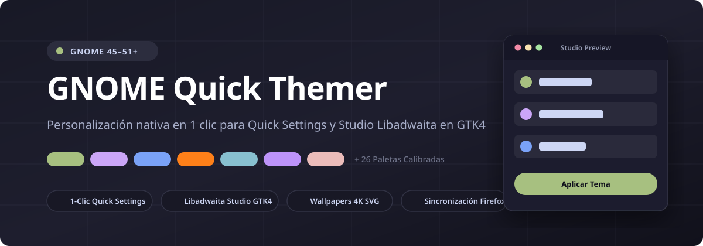
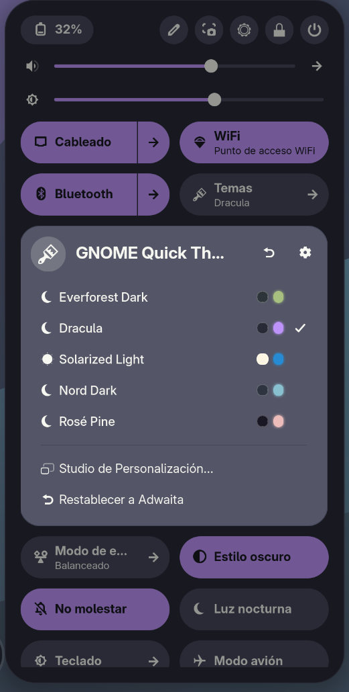
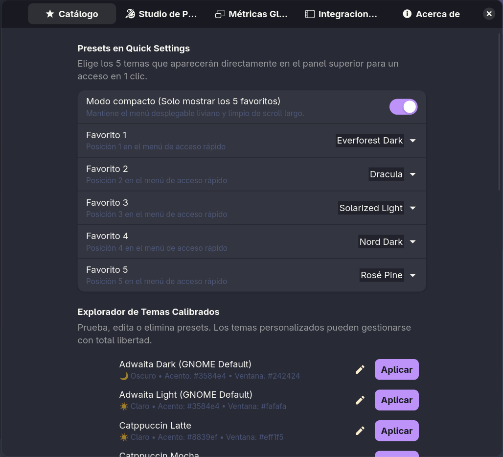
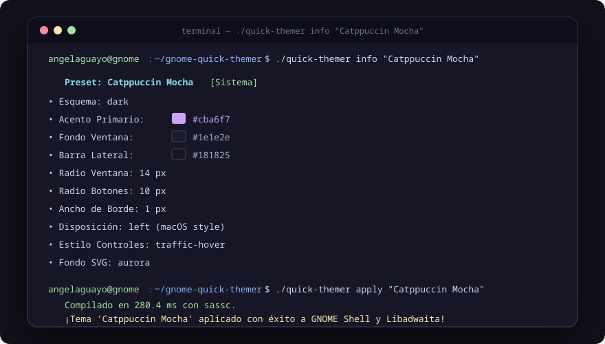

# 🎨 GNOME Quick Themer

[](https://www.gnome.org/)
[](https://gnome.pages.gitlab.gnome.org/libadwaita/)
[-brightgreen?logo=python&style=flat-square)](https://python.org/)
[](https://wayland.freedesktop.org/)
[](LICENSE)

<p align="center">
  
</p>

> **El entorno de diseño y personalización nativo más rápido, fluido y completo para GNOME Shell y Libadwaita.**  
> Cambia, diseña y aplica temas con armonía matemática en **1 clic** directamente desde la barra superior (*Quick Settings*), o crea tus propias paletas personalizadas con un **Studio visual 100% nativo en Libadwaita (GTK4)**.

---

## 📸 Capturas de Pantalla

| ⚡ Acceso Rápido (Quick Settings) | 🎨 Studio Libadwaita GTK4 (`prefs.js`) |
|:---:|:---:|
|  |  |
| *Muestras de color en vivo y presets favoritos en 1 clic* | *Selectores de color visuales nativos, bordes y layout de botones* |

<p align="center">
  <b>💻 CLI Headless de Terminal Ultrarrápido (Zero Pip Deps)</b><br>
  
  <br>
  <i>Gestión, compilación y aplicación instantánea de temas con muestras de color ANSI para scripts y dotfiles</i>
</p>

---

## ⚡ ¿Por qué GNOME Quick Themer?

A diferencia de herramientas que requieren servidores web locales en segundo plano (Flask, Node, navegadores pesados) o configuradores externos desactualizados:

* 🚀 **100% Nativo de GNOME**: Se integra como un menú toggle en el panel superior (*Quick Settings*, junto a Wi-Fi y Volumen) compatible con **GNOME Shell 45, 46, 47, 48, 49, 50 y 51+**.
* 🎨 **Muestras de Color en Vivo (Swatches)**: Cada tema muestra en el menú sus tonos reales de ventana y acento antes de aplicarlo.
* 🛠️ **Libadwaita Studio Integrado (`prefs.js`)**: Ventana de configuración nativa en GTK4 con selector de color interactivo, sliders de esquinas (`border-radius`), grosor de bordes y selector de disposición de botones (*macOS a la izquierda* o *GNOME a la derecha*).
* ⚡ **Live Hot-Reload sin Reiniciar Sesión**: Aplica temas en caliente en Wayland mediante pulsos seguros de `dconf` sin parpadeos ni pérdida de ventanas abiertas.
* 🖼️ **Fondos de Pantalla 4K Vectoriales Automáticos**: Generador matemático en Python puro que crea y aplica un fondo SVG 4K que combina armónicamente con tu paleta activa.
* 🦊 **Sincronización Total del Ecosistema**: Propaga el estilo a **GTK 4 (Libadwaita)**, **GTK 3**, **GNOME Shell**, **aplicaciones Flatpak aisladas** y perfiles de **Firefox / LibreWolf / Waterfox** (`userChrome.css`).
* 💻 **CLI Ultrarrápido Sin Dependencias**: Incluye `./quick-themer` independiente para usuarios de terminal, dotfiles y automatizaciones headless.

---

## 🖥️ Distribuciones Compatibles

GNOME Quick Themer funciona en cualquier distribución Linux con **GNOME Shell 45 o superior**:

| Distribución | Versión mínima | Notas |
|---|:---:|---|
| **Fedora** | 39+ | Primera clase — el escritorio GNOME de referencia |
| **Ubuntu** | 24.04 LTS+ | GNOME 46 incluido por defecto |
| **Debian** | 13 (Trixie)+ | GNOME 46+ |
| **Linux Mint (EDGE)** | 22+ | Requiere la variante con GNOME Shell |
| **Arch Linux** | Rolling | Siempre actualizado |
| **Manjaro** | Rolling (GNOME edition) | — |
| **EndeavourOS** | Rolling (GNOME edition) | — |
| **openSUSE Tumbleweed** | Rolling | — |
| **openSUSE Leap** | 15.6+ | GNOME 45+ |
| **Vanilla OS** | 2+ | — |
| **NixOS** | 24.05+ | Ver nota NixOS más abajo |
| **Pop!_OS** | 24.04+ | GNOME edition |

> **¿Cómo verifico mi versión de GNOME Shell?**  
> Ejecuta en la terminal: `gnome-shell --version`

---

## 📋 Requisitos del Sistema

### Obligatorios

| Requisito | Versión mínima | Paquete |
|---|:---:|---|
| **GNOME Shell** | 45 | `gnome-shell` |
| **Python 3** | 3.9 | `python3` |
| **sassc** (compilador SCSS) | cualquiera | `sassc` |
| **glib-compile-schemas** | cualquiera | `glib2-devel` / `libglib2.0-dev-bin` |

### Opcionales pero Recomendados

| Requisito | Para qué se usa |
|---|---|
| **gnome-shell-extension-user-theme** | Cambio en vivo del tema de GNOME Shell (barra superior, visión general) |
| **Firefox / LibreWolf / Waterfox** | Sincronización automática de `userChrome.css` |
| **Flatpak** | Propagación de estilos a apps aisladas en `~/.var/app/` |

### Instalar dependencias obligatorias

```bash
# Fedora / RHEL / CentOS Stream:
sudo dnf install python3 sassc glib2-devel

# Ubuntu / Debian / Pop!_OS / Linux Mint:
sudo apt install python3 sassc libglib2.0-dev-bin

# Arch Linux / Manjaro / EndeavourOS:
sudo pacman -S python sassc glib2

# openSUSE Tumbleweed / Leap:
sudo zypper install python3 sassc glib2-devel
```

### Instalar User Themes (recomendado)

```bash
# Fedora:
sudo dnf install gnome-shell-extension-user-theme

# Ubuntu / Debian:
sudo apt install gnome-shell-extensions

# Arch:
sudo pacman -S gnome-shell-extensions

# O instala directamente desde el navegador:
# https://extensions.gnome.org/extension/19/user-themes/
```

> **NixOS**: Añade `pkgs.sassc`, `pkgs.glib` y `pkgs.python3` a tu `environment.systemPackages`. La extensión puede instalarse como symlink desde el store con `home.file`.

---

## 📦 Instalación

### 1. Clona el repositorio

```bash
git clone https://github.com/angelaguayo/gnome-quick-themer.git
cd gnome-quick-themer
```

### 2. Ejecuta el instalador

```bash
./install.sh
```

El script verificará automáticamente todas las dependencias, compilará los esquemas de GSettings y registrará la extensión en tu entorno GNOME.

### 3. Reinicia GNOME Shell

> ⚠️ **Este paso es obligatorio** para que GNOME Shell cargue la nueva extensión.

| Sesión | Cómo reiniciar |
|---|---|
| **Wayland** (sesión estándar actual) | Cierra sesión (`Ctrl+Alt+Del`) y vuelve a entrar |
| **X11** (sesión Xorg) | Presiona `Alt+F2`, escribe `r`, pulsa `Enter` |

---

## 🕹️ Modos de Uso

### 1. Desde el Panel Superior (Quick Settings)

Haz clic en el botón de **Temas** en la esquina superior derecha de tu pantalla:
* **Favoritos de 1 Clic**: Accede al instante a tus 5 paletas favoritas con sus círculos de color.
* **Catálogo Completo**: Despliega y aplica cualquiera de los 26 presets o tus temas creados.
* **Botones Rápidos**: Abre el *Studio de Personalización* o *Restablece a Adwaita original* directamente desde el menú.

---

### 2. Studio de Personalización Nativo (Libadwaita GTK4)

Abre el Studio desde el ícono de engranaje del panel, o ejecutando en tu terminal:
```bash
gnome-extensions prefs quick-themer@angelaguayo.github.io
```

La ventana de preferencias se organiza en 3 páginas intuitivas:

#### 🌟 Catálogo
* Configura cuáles 5 temas ocupan las posiciones preferentes en el panel superior.
* Activa el **Modo Compacto** para mantener el menú desplegable ligero.
* Explora la biblioteca completa: aplica cualquier tema con un clic, ábrelo en el editor o elimina presets personalizados.

#### 🎨 Diseñador (Creador y Editor de Paletas)
* **Plantilla Base**: Elige cualquier preset existente como punto de partida.
* **Modo Claro / Oscuro**: Diseña esquemas con variantes `dark` o `light`.
* **Colores esenciales**: Acento, fondo de ventana, sidebar y headerbar visibles de inmediato.
* **Colores avanzados** (expandibles): Superficie elevada, texto principal, texto secundario y colores de borde.
* **Geometría de Ventanas**:
  * **Radio de ventana** (0–32 px): desde esquinas cuadradas hasta ultra redondeadas.
  * **Radio de botones** (0–24 px): redondeo de controles interactivos.
  * **Grosor de borde** (0–4 px): desde ventanas sin borde hasta contornos marcados.
  * **Disposición de botones**: Derecha (GNOME), Izquierda (macOS), Compacto.
  * **Estilo de controles**: macOS Traffic Lights o Adwaita Estándar.
  * **Estilo de fondo SVG**: Olas, Aurora boreal o Geométrico.

#### ⚙️ Sistema
* Wallpaper 4K, sincronización Firefox, propagación Flatpak y notificaciones toast.
* **Restablecer a Adwaita**: devuelve tu escritorio a los valores de fábrica de GNOME.

---

### 3. Modo Terminal / CLI Headless (`./quick-themer`)

Ideal para automatizaciones, scripts de dotfiles o entornos sin interfaz gráfica:

```bash
# Listar las 26 paletas calibradas con muestras de color ANSI en la terminal
./quick-themer list

# Ver detalles completos, colores y métricas de un preset
./quick-themer info "Catppuccin Mocha"

# Aplicar un tema inmediatamente
./quick-themer apply "Everforest Dark"

# Aplicar con parámetros personalizados de geometría al vuelo
./quick-themer apply "Tokyo Night" --window-radius 16 --button-radius 10 --button-layout left

# Aplicar sin generar fondo de pantalla ni tocar Firefox
./quick-themer apply "Nord Dark" --no-wallpaper --no-firefox

# Crear y compilar un tema custom desde la línea de comandos
./quick-themer custom --save --name "Cyber-Neon" --scheme dark \
  --accent "#00ffff" --bg "#10141d" --sidebar "#0a0e14" --headerbar "#070a0e" \
  --window-radius 14 --layout left

# Eliminar un preset personalizado creado por el usuario
./quick-themer delete "Cyber-Neon"

# Consultar el estado activo del escritorio GNOME
./quick-themer status

# Restablecer GNOME a los valores de fábrica
./quick-themer reset
```

---

## 🎨 Catálogo de las 26 Paletas Maestras

GNOME Quick Themer incluye 26 paletas calibradas profesionalmente para garantizar contraste WCAG y elegancia visual:

| Paleta | Modo | Acento Principal | Estética |
|---|:---:|:---:|---|
| **Everforest Dark / Light** | 🌙 / ☀️ | `#a7c080` (Verde bosque) | Tonos naturales, orgánicos y relajantes |
| **Catppuccin Mocha / Latte** | 🌙 / ☀️ | `#cba6f7` (Malva pastel) | La aclamada paleta pastel para desarrolladores |
| **Tokyo Night / Day** | 🌙 / ☀️ | `#7aa2f7` (Azul neón) | Luces nocturnas inspiradas en Shibuya |
| **Nord Dark / Snow Storm** | 🌙 / ☀️ | `#88c0d0` (Azul escandinavo) | Paleta ártica, limpia y minimalista |
| **Gruvbox Dark / Light** | 🌙 / ☀️ | `#fe8019` (Naranja retro) | Tonos cálidos y nostálgicos inspirados en vim |
| **Kanagawa Wave** | 🌙 | `#7e9cd8` (Azul ola) | Tonos tradicionales japoneses de pinturas ukiyo-e |
| **Dracula** | 🌙 | `#bd93f9` (Púrpura gótico) | Oscuridad vibrante con contrastes fluorescentes |
| **Rosé Pine / Dawn** | 🌙 / ☀️ | `#ebbcba` (Rosa empolvado) | Estética sobria, chic y elegante |
| **Solarized Dark / Light** | 🌙 / ☀️ | `#268bd2` (Azul Solarized) | Clásico indiscutible de máxima ergonomía ocular |
| **One Dark Pro / One Light** | 🌙 / ☀️ | `#61afef` (Azul Atom) | El icónico esquema de Atom y VS Code |
| **Monokai Pro** | 🌙 | `#ffd866` (Amarillo oro) | Paleta profesional de alto contraste para editores |
| **Cyberpunk 2077** | 🌙 | `#ffee00` (Amarillo ciber) | Distopía futurista amarilla con fondos de carbón |
| **Adwaita Dark / Light** | 🌙 / ☀️ | `#3584e4` (Azul GNOME) | La experiencia fiel y original de GNOME |

---

## 💾 Gestión de Presets Personalizados

Los presets personalizados se almacenan de forma segura en:
```
~/.config/gnome-quick-themer/custom_presets.json
```

Puedes guardar este archivo en tus **dotfiles**, sincronizarlo entre ordenadores o compartirlo con la comunidad. Cada preset contiene todos los colores HEX y parámetros de ventana de manera independiente.

---

## 🏗️ Arquitectura y Principios de Diseño

```
                                 [ Quick Settings Menu (extension.js) ]
                                                   │
                                                   ▼
[ Preferences Studio (prefs.js) ] ────► [ Engine Runner (quick-themer) ]
                                                   │
                        ┌──────────────────────────┴──────────────────────────┐
                        ▼                                                     ▼
             [ SCSS Compiler (sassc) ]                             [ System Installer ]
                        │                                                     │
             ┌──────────┴──────────┐                               ┌──────────┴──────────┐
             ▼                     ▼                               ▼                     ▼
     ~/.themes/<Name>/    ~/.config/gtk-4.0/                 GNOME Shell        Firefox & Flatpak
```

* **Cero desfase en ToolbarView**: Implementación estricta de fondos continuos en la barra superior de Nautilus y apps con sidebar split-view.
* **Compilación SCSS en memoria**: Las plantillas maestras en `base_theme/` son inmutables; el compilador inyecta variables dinámicas en un workspace aislado antes de generar los CSS.
* **Procesamiento asíncrono no bloqueante**: Todas las llamadas a subprocesos usan `Gio.Subprocess` con callbacks asíncronos para garantizar que el compositor Mutter jamás pierda un fotograma.

---

## 🔧 Solución de Problemas

### La extensión no aparece en Quick Settings después de instalar
* Verifica que reiniciaste GNOME Shell (cierra sesión y vuelve a entrar en Wayland).
* Comprueba que la extensión está habilitada: `gnome-extensions list --enabled`
* Verifica que tu versión de GNOME Shell es compatible: `gnome-shell --version` (necesita ≥ 45)

### Error: `sassc: command not found`
Instala `sassc` con tu gestor de paquetes (ver sección [Requisitos](#-requisitos-del-sistema)).

### Error: `glib-compile-schemas: command not found`
```bash
# Fedora:  sudo dnf install glib2-devel
# Ubuntu:  sudo apt install libglib2.0-dev-bin
# Arch:    sudo pacman -S glib2
```

### El tema no se aplica a Firefox
* Verifica que Firefox, LibreWolf o Waterfox está instalado.
* El script busca perfiles en `~/.mozilla/firefox/`, `~/.config/mozilla/firefox/`, así como variantes Flatpak y Snap.
* Asegúrate de que la opción **Firefox Sync** está activada en el Studio (página Sistema).

### Los cambios de tema no se ven en aplicaciones Flatpak
* Activa la opción **Flatpak Propagation** en la página Sistema del Studio.
* Puede requerir cerrar y reabrir las aplicaciones Flatpak.

### El fondo de pantalla no cambia
* Verifica que **Fondo de Pantalla 4K** está activado en la página Sistema.
* Comprueba que `python3` está disponible en el PATH: `python3 --version`

### El Studio de Personalización muestra error de directorio
Esto ocurre si el instalador se ejecutó con una ruta diferente. Solución:
```bash
# Desde el directorio del proyecto clonado:
./install.sh
```

---

## 🗑️ Desinstalación Limpia

Si alguna vez deseas desinstalar la herramienta y devolver tu entorno GNOME a su configuración original:

```bash
./uninstall.sh
```

El script te preguntará si también deseas eliminar tus presets personalizados (`~/.config/gnome-quick-themer/`), restablecerá el tema GTK de fábrica y desenlazará la extensión de GNOME Shell.

---

## 🤝 Contribuciones

¡Las contribuciones son bienvenidas!
* ¿Tienes una paleta calibrada que te gustaría incluir en `presets.json`? Envía un Pull Request.
* ¿Encontraste un problema o tienes una sugerencia? Abre un Issue en GitHub.

---

## 📄 Licencia

Este proyecto está liberado bajo la licencia de código abierto [MIT License](LICENSE).  
Desarrollado con dedicación para la comunidad de **GNOME** y **Linux**.
